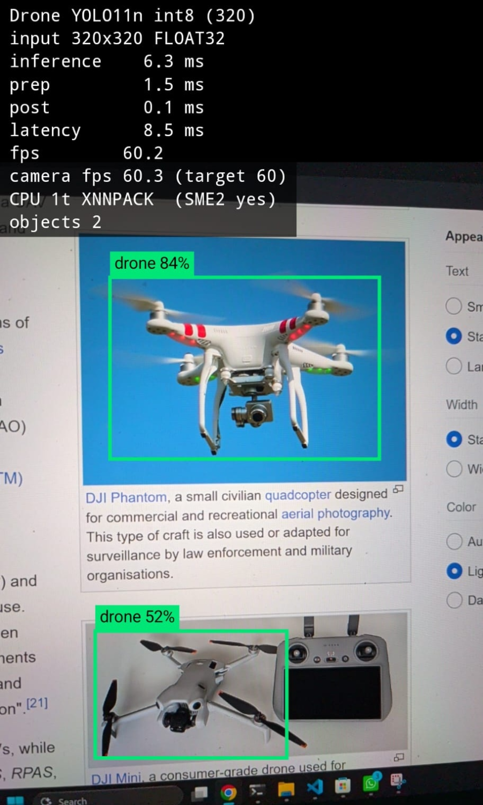

My new phone's CPU runs AI faster than its GPU. I didn't expect that either.

I recently got a Pixel 11. After the usual five hours of moving stuff over from the old phone, I took a quick look at what the new Tensor G6 chip adds. One item on the spec sheet caught my eye: SME2, an Arm extension. If you're into AI, this one matters, because it makes matmul faster.

What's matmul? It's the basic building block of most AI models. Put simply, it means multiplying matrices, and those matrices hold the weights of a neural network's layers.

How does SME2 help? It switches the Arm CPU into a streaming mode, where it can run instructions that work on a new grid of accumulators called ZA, held inside a dedicated matrix unit. Here is a simplified picture of the difference:

```python
# NEON: the CPU does the work itself, 4 numbers per instruction
for i in range(64):
    for j in range(0, 64, 4):
        for k in range(64):
            C[i, j:j+4] += A[i, k] * B[k, j:j+4]       # 4 multiply-adds

# SME2: the CPU hands 16×16 tiles to the matrix unit
for i in range(0, 64, 16):
    for j in range(0, 64, 16):
        C[i:i+16, j:j+16] = sme2_multiply_tile(A[i:i+16, :], B[:, j:j+16])
```

```
NEON:  65,536 instructions
SME2:      16 tile calls (1,024 instructions)
```

Same math, but NEON loops over every row, 4 numbers at a time, while SME2 hands the whole job to the matrix unit one 16×16 tile at a time.

My first thought was: let's use Claude and run some benchmarks.

The obvious test was a language model. I ran llama.cpp with a small, heavily quantized model (Llama 3.2 1B, 4-bit) and measured prefill, the part where the model reads your prompt. That part is mostly matmul, so SME2 should shine there.

```
Llama 3.2 1B (4-bit), prefill

Threads   No SME2      SME2         Gain
1          49 tok/s    106 tok/s    2.2×
7         242 tok/s    255 tok/s    +5%
```

Promising but not revolutionary. On one core SME2 more than doubled the speed, but with all cores busy the gain almost disappeared. That was the first hint of something interesting: all CPU cores share one SME2 unit. One thread can already keep it busy.

So one core with SME2 can do a lot. That's perfect for applications that need to sip power while checking images at a steady rate, like... a drone detector!

First, I needed to know if image models benefit. I switched to convolutional networks, the classic models for image recognition. I ran ResNet-50 through XNNPACK, the engine behind TensorFlow Lite (now LiteRT) on Android, on a single thread, with SME2 switched on and off:

```
ResNet-50, 1 thread, time per image

        NEON      SME2      Speedup
fp32    170 ms    35 ms     4.8×
fp16     85 ms    18 ms     4.7×
int8     36 ms    12.5 ms   2.9×
```

(fp32/fp16 are 32- and 16-bit decimal numbers, and int8 is 8-bit whole numbers. Smaller is faster, at a small cost in accuracy.)

Up to 5× vs NEON! One core now runs ResNet-50 in 12.5 ms, which is 80 images per second.

But hold on, wouldn't the GPU be better at this? And benchmarks are one thing, but can it do real work? To find out, I built a small Android app that runs live object detection on the camera feed. With EfficientDet-Lite0, a general object detector, it took 11 ms per frame on one CPU core with SME2, versus 59 ms on the GPU (float model on the GPU, because its runtime can't take int8 input).

Wow, the CPU wins, and it only needed one core.

Time for the drone detector. I took a small open-source YOLO11 drone model, converted it to int8 in Colab and dropped it into the app. Pointed at a photo on my laptop screen, it found both drones (84% and 52% confidence), in 6 ms per frame, at 60 frames per second, on one core.

<figure>



<figcaption>Drone detection on a single CPU core with SME2: 6 ms per frame, 60 FPS. Drone photos: Wikimedia Commons.</figcaption>
</figure>

One surprise along the way: at first it ran at almost 12 ms. The work was so short that Android thought the phone was idle and lowered the CPU clock. Telling Android about the deadline with its performance hint API brought it back to 6 ms.

But a detector doesn't need a screen or 60 frames per second. So I turned it into a background service: screen off, camera on, checking 15 frames per second, and measured the battery drain:

* Camera only: about 1.6 W
* Camera + drone detection at 15 frames per second: about 2.1 W

The AI adds only about 0.5 W, around 35 millijoules per frame. The camera itself uses about twice as much power as the AI. A phone could watch the sky for about 9.5 hours on one charge, or around the clock with a small solar panel.

To sum up:

* **SME2 is a matrix engine inside the CPU, not just faster cores.** It does matrix math in tiles instead of small vectors, and that gave nearly 5× over NEON on image models.
* **One thread is enough.** All cores share one SME2 unit, so a single thread can use all of it while the other cores stay free.
* **For small vision models it beat the GPU** in my tests, using just one core and leaving the rest free.
* **It's efficient.** Detection adds only about 0.5 W on top of the camera, so the camera, not the AI, sets the power budget. That's about 9.5 hours on battery, or always-on with a small solar panel.

Your next AI accelerator might already be in your CPU.

---

Questions, corrections or your own SME2 numbers? Email me at [hello@kkabat.com](mailto:hello@kkabat.com) or join the [llama.cpp discussion](https://github.com/ggml-org/llama.cpp/discussions/32895).
